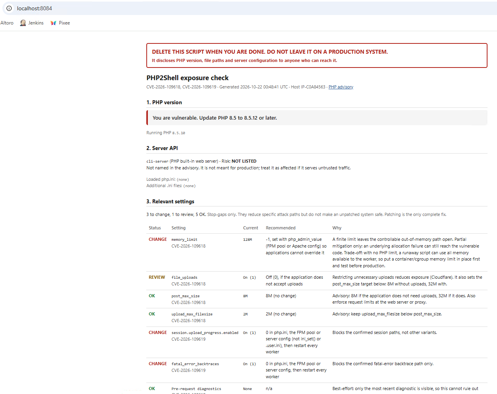
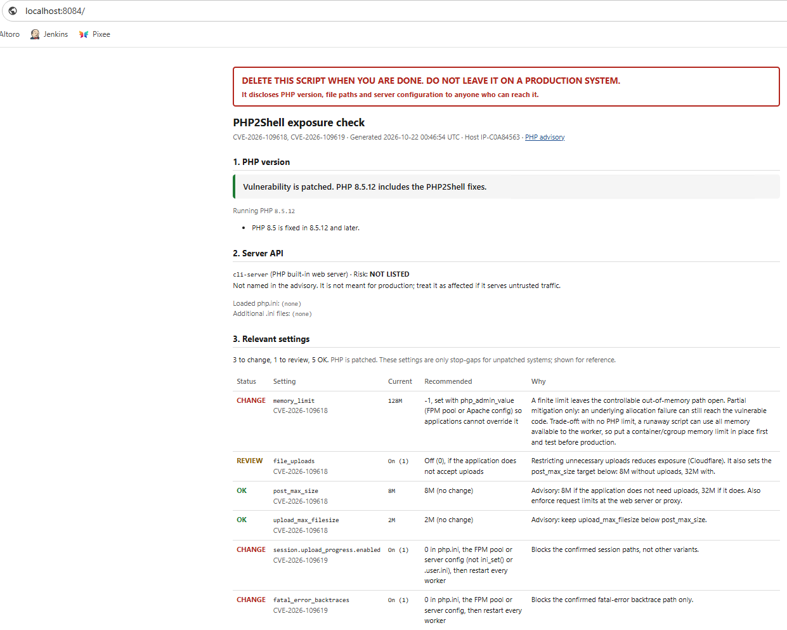
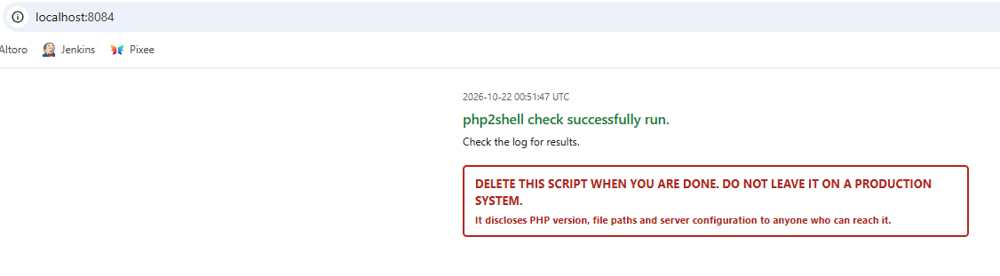

# php2shell-check

Read-only exposure check for PHP2Shell (CVE-2026-109618, CVE-2026-109619)

Checks your php version and determines if you are running a vulnerable or patched php server. Also checks related php.ini settings and other information related to the vulnerability and provides risk reduction mitigation advice for scenarios where an immediate upgrade is impractical. 

## Screenshots

## Requirements
- PHP (any version)

Report sections, in order:
  1. PHP version: patched / update available / no patch available
  2. Server API (SAPI) in use and its risk level per the PHP advisory
  3. Relevant settings: current value -> recommended value
  4. Mitigations this script cannot detect (check these by hand)

## USAGE
### Web (recommended: checks the configuration your web workers actually use)
    1. Add your IP address to $CONFIG['allowed_ips'] below.
    2. Upload into the docroot of each site / FPM pool you want to check, then open it.
         ?format=text   plain-text output
    3. DELETE THE FILE when finished. It discloses server configuration.
### CLI
    > php php2shell_check.php
    Exit codes without logging: 0 = patched, 1 = vulnerable, 2 = cannot confirm
    Exit codes with logging:    0 = report written, 3 = not written (busy or write failed)
    The CLI often loads a different php.ini than the web server, so CLI results describe the CLI only.
### OUTPUT MODES (decided only by $CONFIG['log_file']; no URL or CLI parameter changes it)
    log_file empty : the full report is shown on screen.
    log_file set   : the report goes ONLY to the log file. The screen shows a timestamp
                     and a confirmation, never the result or the log location.
    Each write REPLACES the previous report, so the file never grows beyond one report.
    Web writes are throttled; the CLI is not (it already requires shell access).

## SAFETY
  Changes nothing. The only runtime action is ini_set('memory_limit', <current value>)
  to test whether applications can override memory_limit. It sets the value it
  already has and affects this request only.

## LIMITATIONS
  The version check trusts PHP_VERSION from the running binary. It cannot detect
  custom or modified builds whose version string does not match their source.

## SOURCES (as of 2026-10-21)
  PHP advisory : https://www.php.net/archive/2026.php#2026-10-21-5
  Cloudflare   : https://blog.cloudflare.com/php-vulnerabilities-waf-protection/
  Checks marked "(Inferred)" are not in the advisory.

Uses only PHP 5.3-era syntax so it can run on the old versions it reports on.

